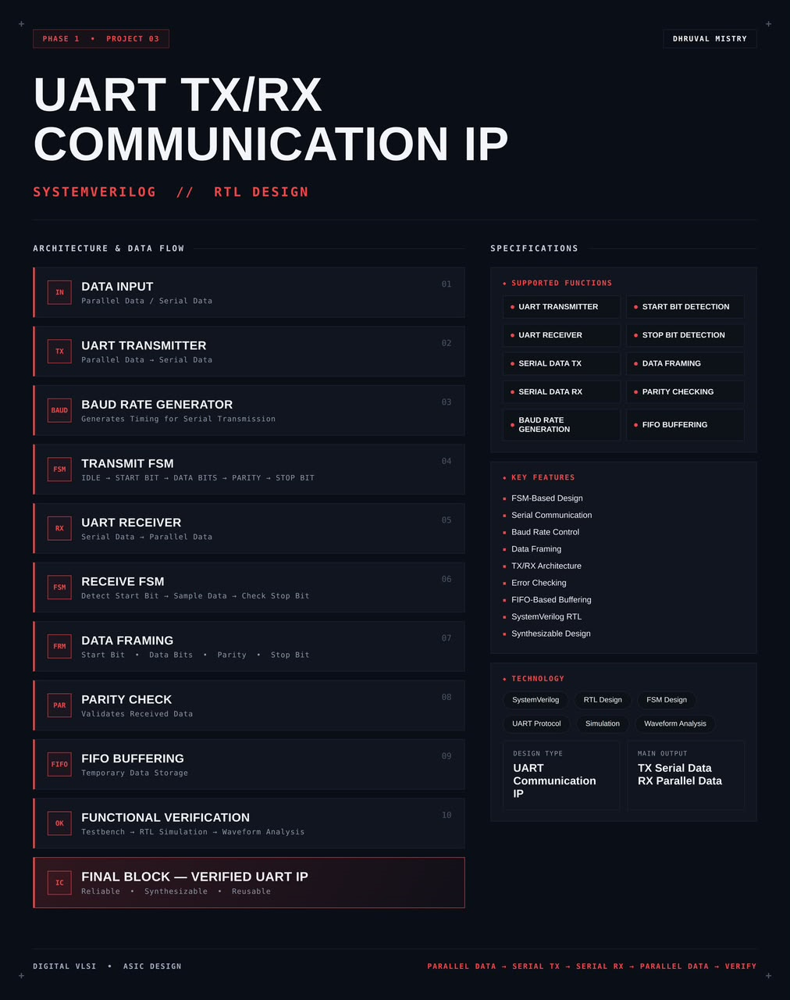
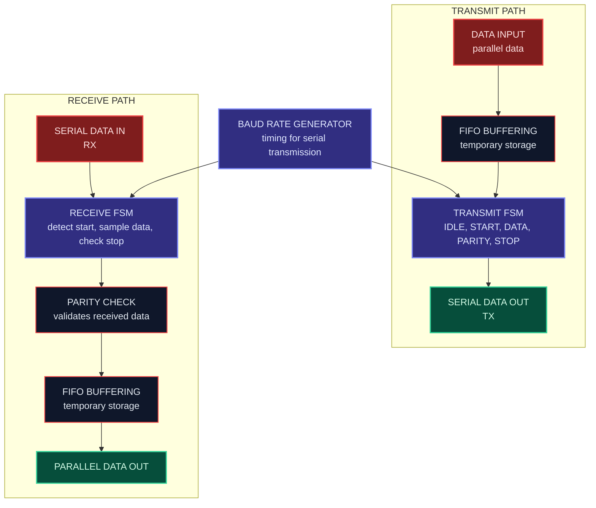
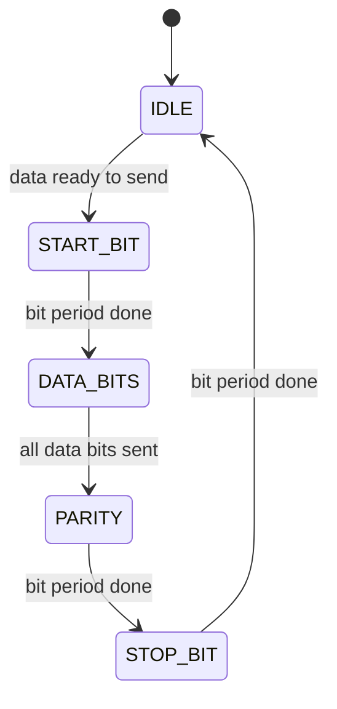
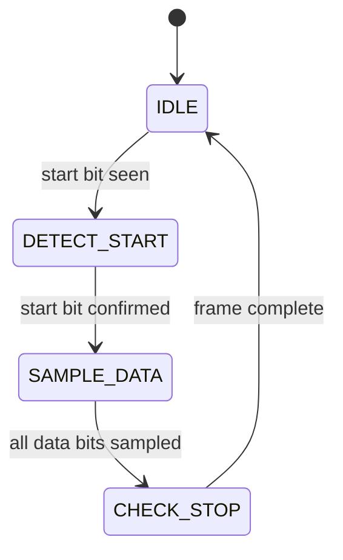
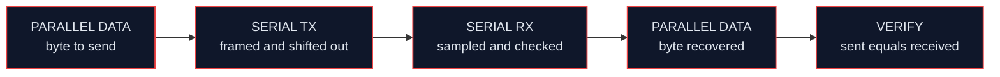
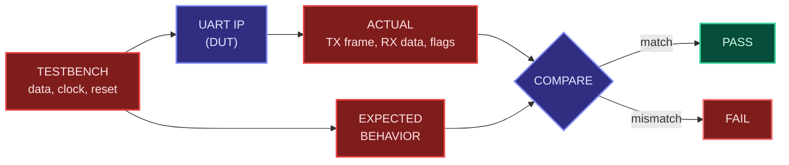

<div align="center">




<b>A synthesizable UART transmitter and receiver IP with baud rate generation, FSM-based framing, parity checking and FIFO buffering, written in SystemVerilog.</b>

<br/>


<br/>

[Overview](#overview) |
[At a Glance](#project-at-a-glance) |
[Background](#background-uart-communication) |
[Functions](#supported-functions) |
[Architecture](#architecture) |
[Functional Description](#functional-description) |
[Frame Format](#frame-format) |
[Interface](#interface) |
[Operating Sequence](#operating-sequence) |
[Getting Started](#getting-started) |
[Verification](#verification) |
[Synthesis](#synthesis) |
[Applications](#applications) |
[FAQ](#faq) |
[License](#license)

</div>

---

## Overview

This project implements a **UART (Universal Asynchronous Receiver/Transmitter) communication IP** in **SystemVerilog**.

The IP has two halves. The **transmitter** takes parallel data, wraps it into a serial frame (start bit, data bits, parity bit and stop bit) and shifts it out on the serial line. The **receiver** watches the serial line, detects the start bit, samples the data bits, checks parity and the stop bit, and returns the data as parallel data. A **baud rate generator** produces the timing that both halves use, and **FIFO buffering** provides temporary data storage so data is not lost while the UART is busy.

Both the transmit and receive sides are controlled by **finite state machines (FSMs)**. The design is **sequential**, written in a **synthesis-friendly** style, simulated at RTL level, inspected through waveform analysis and packaged as a reusable UART IP block.

<table>
<tr>
<td width="50%" valign="top">

#### Objectives
- Design a reusable UART transmitter and receiver in SystemVerilog
- Generate accurate bit timing with a baud rate generator
- Build the transmit and receive logic as clear FSMs
- Frame data with start bit, data bits, parity and stop bit
- Detect parity and stop bit errors on received data
- Buffer data with a FIFO
- Verify the full parallel to serial to parallel path

</td>
<td width="50%" valign="top">

#### Key Features
- FSM-based design
- Serial communication
- Baud rate control
- Data framing
- TX/RX architecture
- Error checking
- FIFO-based buffering
- SystemVerilog RTL
- Synthesizable design

</td>
</tr>
</table>

---

## Project at a Glance

| Attribute | Detail |
|:--|:--|
| **Design type** | UART Communication IP |
| **Description language** | SystemVerilog (RTL) |
| **Logic style** | Sequential, clocked, FSM-based |
| **Architecture** | Separate transmitter and receiver (TX/RX) |
| **Timing** | Baud rate generator |
| **Frame** | Start bit, data bits, parity, stop bit |
| **Error checking** | Parity check, stop bit check |
| **Buffering** | FIFO |
| **Main output** | TX serial data, RX parallel data |
| **Functions** | 10 (transmit, receive, timing, framing, checking, buffering) |
| **Simulation** | Verilator |
| **Waveform analysis** | GTKWave |
| **Synthesis** | Yosys |
| **License** | MIT |

---

## Background: UART Communication

**UART** is one of the most widely used serial communication methods. It sends data one bit at a time over a single wire in each direction, with no shared clock. Because there is no clock line, the transmitter and the receiver must agree in advance on the **baud rate**, which is the number of bits sent per second.

To let the receiver find where each piece of data begins and ends, every byte is sent inside a **frame**. The line sits high when idle. A low **start bit** announces a new frame, the **data bits** follow, an optional **parity bit** allows simple error detection, and a high **stop bit** ends the frame and returns the line to idle.

UART is found in microcontrollers, SoCs, debug consoles and many sensor and communication modules. Designing one covers core RTL skills: FSM design, timing generation, serial-to-parallel conversion, error checking, buffering and verification.

---

## Supported Functions

| Group | Function | Description |
|:--|:--|:--|
| **Transmit** | `UART TRANSMITTER` | Converts parallel data into a serial frame |
| **Transmit** | `SERIAL DATA TX` | Shifts the frame out on the serial transmit line |
| **Receive** | `UART RECEIVER` | Converts serial data back into parallel data |
| **Receive** | `SERIAL DATA RX` | Reads the serial receive line |
| **Timing** | `BAUD RATE GENERATION` | Generates the timing for serial transmission |
| **Framing** | `START BIT DETECTION` | Detects the falling edge that begins a frame |
| **Framing** | `STOP BIT DETECTION` | Checks the stop bit at the end of a frame |
| **Framing** | `DATA FRAMING` | Builds and decodes start, data, parity and stop bits |
| **Checking** | `PARITY CHECKING` | Validates received data using the parity bit |
| **Buffering** | `FIFO BUFFERING` | Stores data temporarily |

---

## Architecture

The design is organized as a data input stage, a transmit path (FIFO, transmit FSM and framing), a receive path (receive FSM, parity check and FIFO) and a baud rate generator that supplies timing to both.

#### Block diagram

```text
  TRANSMIT PATH
  +------------+     +------------+     +--------------------+
  | PARALLEL   |     |   FIFO     |     |   UART TRANSMITTER |
  | DATA IN    |---->|  BUFFERING |---->|   TRANSMIT FSM     |----> SERIAL DATA OUT (TX)
  +------------+     +------------+     |   DATA FRAMING     |
                                        +---------^----------+
                                                  |  bit timing
                                        +---------+----------+
        CLK, RESET ---------------------> BAUD RATE GENERATOR |
                                        +---------+----------+
                                                  |  bit timing
  RECEIVE PATH                                    v
  +------------+     +------------+     +--------------------+     +------------+
  | SERIAL     |     |    UART    |     |       PARITY       |     |   FIFO     |
  | DATA IN    |---->|  RECEIVER  |---->|       CHECK        |---->|  BUFFERING |----> PARALLEL DATA OUT
  | (RX)       |     | RECEIVE FSM|     |                    |     |            |
  +------------+     +------------+     +--------------------+     +------------+
```

#### Data flow



#### Block breakdown

| # | Block | Role |
|:-:|:--|:--|
| `01` | **Data Input** | Accepts parallel data for transmission and serial data for reception |
| `02` | **UART Transmitter** | Converts parallel data into serial data |
| `03` | **Baud Rate Generator** | Generates the timing for serial transmission |
| `04` | **Transmit FSM** | Steps through IDLE, START BIT, DATA BITS, PARITY and STOP BIT |
| `05` | **UART Receiver** | Converts serial data into parallel data |
| `06` | **Receive FSM** | Detects the start bit, samples the data and checks the stop bit |
| `07` | **Data Framing** | Start bit, data bits, parity and stop bit |
| `08` | **Parity Check** | Validates the received data |
| `09` | **FIFO Buffering** | Temporary data storage |
| `10` | **Functional Verification** | Testbench, RTL simulation and waveform analysis |

> **Final design block:** `PARALLEL DATA -> SERIAL TX -> SERIAL RX -> PARALLEL DATA`

---

## Functional Description

#### Data input
Parallel data enters the transmit side and serial data enters the receive side. The two directions work independently, so the UART can send and receive at the same time.

#### UART transmitter
Takes parallel data and sends it out one bit at a time on the serial line, wrapped in a frame. It is driven by the transmit FSM and the baud rate generator.

#### Baud rate generator
Divides the system clock down to the bit rate. It produces a timing pulse once per bit period, and the transmit and receive FSMs advance on that timing. The number of clock cycles per bit is the system clock frequency divided by the baud rate.

#### Transmit FSM
Controls the order in which the frame is sent.



| State | Action |
|:--|:--|
| `IDLE` | Line is held high and the transmitter waits for data |
| `START_BIT` | Line is driven low for one bit period |
| `DATA_BITS` | Data bits are shifted out one per bit period |
| `PARITY` | The parity bit is sent |
| `STOP_BIT` | Line is driven high for the stop bit, then returns to idle |

#### UART receiver
Watches the serial line and rebuilds each frame into parallel data. It is driven by the receive FSM and the same baud rate timing.

#### Receive FSM
Controls how an incoming frame is captured.



| State | Action |
|:--|:--|
| `IDLE` | Waits for the line to fall low |
| `DETECT_START` | Detects the start bit that begins the frame |
| `SAMPLE_DATA` | Samples each data bit once per bit period |
| `CHECK_STOP` | Checks that the stop bit is high, then returns to idle |

#### Data framing
Defines the frame wrapped around each byte: a start bit, the data bits, a parity bit and a stop bit. See [Frame Format](#frame-format).

#### Parity check
Validates received data. The parity bit is compared against the parity of the received data bits, and a mismatch marks the data as corrupted.

#### FIFO buffering
A first-in, first-out buffer that holds data temporarily. It lets the rest of the system hand over or collect data at its own pace without losing bytes while the UART is busy with a frame.

---

## Frame Format

Each byte is sent inside a frame. The line is high while idle.

```text
 idle     start    data bits                       parity   stop    idle
 ------+          +----+----+----+----+----+----+----+-----+--------------
       |  START   | D0 | D1 | D2 | D3 | D4 | D5 | D6 | D7 |  P   |  STOP
       +----------+----+----+----+----+----+----+----+----+------+
       low         <------- data bits ------->        parity       high
```

| Field | Level | Purpose |
|:--|:-:|:--|
| Idle | High | Line rests high between frames |
| Start bit | Low | Announces the start of a new frame |
| Data bits | Data | The payload |
| Parity bit | Parity | Allows simple error detection |
| Stop bit | High | Marks the end of the frame |

The width of the data field, the parity type, the number of stop bits and the bit order are defined in the RTL (see the configuration table under [Interface](#interface)).

#### Worked example (illustrative)

Sending the byte `0x41` (`8'b0100_0001`) with 8 data bits, one parity bit and one stop bit, least significant bit first:

| Field | Bit value on the line |
|:--|:--|
| Start bit | `0` |
| Data bits (D0 to D7) | `1 0 0 0 0 0 1 0` |
| Parity bit, even parity | `0` (the data has two 1s) |
| Parity bit, odd parity | `1` |
| Stop bit | `1` |

Illustrative timing for 115200 baud with a 50 MHz clock:

| Quantity | Calculation | Value |
|:--|:--|:--|
| Clock cycles per bit | 50,000,000 / 115,200 | about 434 |
| Bits per frame | 1 start + 8 data + 1 parity + 1 stop | 11 |
| Frame duration | 11 / 115,200 | about 95.5 microseconds |
| Data throughput | 115,200 x 8 / 11 | about 83,800 data bits per second |

These numbers only show how the baud rate relates to the clock. The actual clock frequency, baud rate and frame format used by this IP are listed in the configuration table.

---

## Interface

#### Ports

| Port | Direction | Description |
|:--|:-:|:--|
| Clock | Input | System clock for all sequential logic |
| Reset | Input | Resets the UART to its initial state |
| Parallel data in | Input | Data to be transmitted |
| Transmit request | Input | Tells the transmitter that data is ready to send |
| Serial data out (TX) | Output | Serial transmit line |
| Serial data in (RX) | Input | Serial receive line |
| Parallel data out | Output | Data recovered by the receiver |
| Receive valid | Output | Indicates that received data is available |
| Error flags | Output | Parity error and stop bit error indications |

Exact port names, widths and reset polarity are defined in the RTL sources under `rtl/`.

#### Configuration

| Item | Value |
|:--|:-:|
| System clock frequency | `TBD` |
| Baud rate | `TBD` |
| Data bits per frame | `TBD` |
| Parity type | `TBD` |
| Stop bits | `TBD` |
| Bit order | `TBD` |
| FIFO depth | `TBD` |

---

## Operating Sequence

The UART follows the same path every time: parallel data in, serial transmit, serial receive, parallel data out, then verify.



1. **Load data.** A byte is presented on the parallel input and placed in the transmit FIFO.
2. **Frame and send.** The transmit FSM adds the start bit, sends the data bits, adds the parity bit and ends with the stop bit, one bit per baud period.
3. **Detect and sample.** The receive FSM detects the start bit and samples each data bit.
4. **Check.** Parity and the stop bit are checked, and errors are flagged.
5. **Deliver.** The recovered byte is stored in the receive FIFO and read out as parallel data.

---

## Repository Structure

```text
uart-tx-rx-communication-ip/
├── rtl/
│   ├── baud_rate_gen.sv        # Baud rate generator
│   ├── uart_tx.sv              # Transmitter and transmit FSM
│   ├── uart_rx.sv              # Receiver and receive FSM
│   ├── fifo.sv                 # FIFO buffer
│   └── uart_top.sv             # Top-level UART IP
├── tb/
│   └── uart_tb.sv              # Self-checking testbench
├── sim/
│   └── waves.vcd               # Generated waveform dump
├── synth/
│   ├── synth.ys                # Yosys synthesis script
│   ├── uart_netlist.v          # Gate-level netlist
│   └── synth_report.txt        # Yosys stat report
├── LICENSE
└── README.md
```

---

## Technology Stack

| Tool | Role in this project |
|:--|:--|
|  | RTL design and testbench |
|  | Compiles and simulates the design |
|  | Views the simulation waveforms |
|  | Synthesizes the RTL to a gate-level netlist |

---

## Getting Started

#### Prerequisites

| Tool | Purpose | Version |
|:--|:--|:--|
| Verilator | RTL simulation | 5.x or later |
| GTKWave | Waveform viewer | Any recent |
| Yosys | RTL synthesis | Any recent |

```bash
# Ubuntu / Debian
sudo apt update
sudo apt install verilator gtkwave yosys
```

#### 1. Clone

```bash
git clone https://github.com/dhruvalmistry2007/uart-tx-rx-communication-ip.git
cd uart-tx-rx-communication-ip
```

#### 2. Simulate

```bash
verilator --binary --trace -Wall --top-module uart_tb \
  rtl/baud_rate_gen.sv rtl/uart_tx.sv rtl/uart_rx.sv rtl/fifo.sv rtl/uart_top.sv tb/uart_tb.sv
./obj_dir/Vuart_tb
```

#### 3. View waveforms

```bash
gtkwave sim/waves.vcd
```

#### 4. Synthesize

```bash
yosys -p "read_verilog -sv rtl/baud_rate_gen.sv rtl/uart_tx.sv rtl/uart_rx.sv rtl/fifo.sv rtl/uart_top.sv; synth -top uart_top; stat; write_verilog synth/uart_netlist.v"
```

---

## Verification

The testbench drives parallel data into the transmitter, checks the serial frame on the TX line, feeds serial frames into the receiver and checks the recovered parallel data. Results are then inspected as waveforms.



#### Test plan

| Area | Scenario | Expected behavior |
|:--|:--|:--|
| Reset | Apply reset | Both FSMs return to IDLE and the TX line is high |
| Transmit | Send a single byte | Frame appears on TX with the correct start, data, parity and stop bits |
| Frame format | Inspect an idle to idle frame | Start bit is low, stop bit is high |
| Baud timing | Measure the bit period on TX | Each bit lasts the configured number of clock cycles |
| Parity | Send bytes with an even and an odd number of 1s | Parity bit matches the configured parity |
| Receive | Feed a valid frame into RX | Correct parallel data is recovered and valid is raised |
| Start bit detection | Drive RX low after idle | Receiver leaves IDLE and begins sampling |
| Parity error | Feed a frame with a wrong parity bit | Parity error is flagged |
| Stop bit error | Feed a frame with a low stop bit | Stop bit error is flagged |
| Back-to-back frames | Send several bytes in a row | Every byte is received in order |
| FIFO order | Write several bytes, then read them | Bytes come out in the order they went in |
| Loopback | Connect TX to RX and sweep byte values | Received byte equals the transmitted byte |
| Corner values | Send `0x00` and `0xFF` | Data is transmitted and received unchanged |

#### Coverage matrix

| Area | Functions checked | Result |
|:--|:--|:-:|
| Transmit | UART transmitter, serial data TX, transmit FSM | `TBD` |
| Receive | UART receiver, serial data RX, receive FSM | `TBD` |
| Timing | Baud rate generation | `TBD` |
| Framing | Start bit, stop bit, data framing | `TBD` |
| Checking | Parity checking, error flags | `TBD` |
| Buffering | FIFO buffering | `TBD` |

#### Waveform analysis checklist

| Signal | What to confirm |
|:--|:--|
| Clock and reset | Reset puts the UART in its initial state |
| TX line | Idle high, then start bit, data bits, parity and stop bit at the right spacing |
| Baud timing | Constant bit period across the whole frame |
| RX line | Receiver samples each data bit within its bit period |
| Parallel output | Matches the transmitted byte |
| Error flags | Raised only for bad parity or a bad stop bit |
| FIFO | Data order is preserved |

---

## Synthesis

The RTL is synthesized with **Yosys** to confirm that the design is synthesizable. The flow reads the SystemVerilog sources, elaborates the design hierarchy, maps it to generic logic cells, prints a cell statistics report and writes the gate-level netlist. The netlist and the report are stored in [`synth/`](synth/).


| Step | Command | Purpose |
|:--|:--|:--|
| Read | `read_verilog -sv` | Loads the SystemVerilog RTL |
| Synthesize | `synth -top uart_top` | Elaborates and maps the design to generic gates |
| Report | `stat` | Prints cell and wire statistics |
| Export | `write_verilog` | Writes the gate-level netlist |

#### Results

| Metric | Value |
|:--|:-:|
| Top module | `uart_top` |
| Total cells | `TBD` |
| Flip-flops | `TBD` |
| Wires / wire bits | `TBD` |
| Logic depth / critical path | `TBD` |
| Area | `TBD` |

---

## Design Considerations

| Aspect | Approach |
|:--|:--|
| **Logic style** | Sequential design built from clocked registers and FSMs |
| **Structure** | Separate transmitter and receiver, so TX and RX work independently |
| **Timing** | One baud rate generator supplies bit timing to both FSMs |
| **Framing** | Start bit, data bits, parity bit and stop bit in every frame |
| **Error checking** | Parity check and stop bit check on received data |
| **Buffering** | FIFO decouples the UART from the rest of the system |
| **Synthesis** | Synthesizable RTL structure, targeting a Yosys flow |
| **Verification** | Simulation-based, with directed tests and waveform inspection |

#### Current limitations
- Simulation-based verification only, with no formal verification
- Frame format is fixed by the RTL configuration
- No hardware flow control signals

---

## Applications

- Debug and console interfaces in microcontrollers and SoCs
- Communication with sensor, GPS and wireless modules
- Board-to-board and chip-to-chip serial links
- Bootloader and firmware download channels
- Reusable serial peripheral in ASIC and FPGA designs
- Teaching and reference design for FSM-based serial communication

---

## Customization

#### Change the baud rate

The baud rate is set by how many system clock cycles make up one bit period. Change the baud rate setting (or the divisor in the baud rate generator) so that:

```text
clock cycles per bit = system clock frequency / baud rate
```

#### Change the frame format

1. Update the number of data bits, the parity type or the number of stop bits in the configuration.
2. Update the matching states in the transmit and receive FSMs.
3. Update the frame format and configuration tables in this README.
4. Add test cases for the new format in the testbench and re-run the simulation.

---

## Troubleshooting

| Problem | Likely cause | Fix |
|:--|:--|:--|
| `--binary` option not recognized | Verilator version is older than 5.x | Upgrade Verilator to 5.x or later |
| `waves.vcd` is not generated | Tracing is not enabled | Build with `--trace` and make sure the testbench calls `$dumpfile` and `$dumpvars` |
| Garbage data on the receiver | Baud rates of TX and RX do not match | Use the same baud rate and clock settings on both sides |
| Receiver misses the start bit | RX line is not idle high before the frame | Hold RX high during reset and between frames |
| Parity error on every frame | Parity type differs between sender and receiver | Use the same parity setting on both sides |
| Stop bit error flagged | Frame is shorter or longer than expected | Check the data bit count and baud timing |
| Yosys cannot find the top module | `-top` name does not match the module name | Use the exact module name from `rtl/uart_top.sv` |
| Missing module errors in Verilator | A source file is missing from the command | Pass every `.sv` file from `rtl/` plus the testbench |

---

## FAQ

**Why do both sides need the same baud rate?**
UART has no clock line. Each side counts clock cycles to find the bit boundaries, so both must use the same bit period.

**Why use FSMs for the transmitter and receiver?**
A frame is a fixed sequence of steps, so an FSM maps to it directly, is easy to verify and synthesizes cleanly.

**Why is there a FIFO?**
The UART takes many clock cycles to send or receive one frame. The FIFO holds data in the meantime, so the rest of the system does not have to wait.

**What does the parity bit do?**
It adds one bit that makes the total number of 1s even (or odd). If one bit flips in transit, the receiver sees the mismatch and flags an error. It detects single-bit errors but cannot correct them.

**What is the stop bit for?**
It guarantees that the line returns high before the next start bit, and it gives the receiver a check that the frame was aligned correctly.

**Why Verilator, GTKWave and Yosys?**
They are free, open-source tools that cover simulation, waveform viewing and synthesis, so the whole project can be reproduced without licenses.

---

## Learning Outcomes

- Designing FSM-based transmit and receive logic in SystemVerilog
- Generating accurate bit timing from a system clock
- Implementing serial-to-parallel and parallel-to-serial conversion
- Adding parity and stop bit error checking
- Using a FIFO to buffer data between blocks
- Building a loopback testbench and debugging with waveform analysis
- Running RTL synthesis and reading the resulting reports

---

## Design Flow


<div align="center">

`PARALLEL DATA` | `SERIAL TX` | `SERIAL RX` | `PARALLEL DATA` | `VERIFY`

</div>

---

## Future Work

- Add configurable baud rate, data width, parity and stop bits through registers
- Add 16x oversampling with majority-vote sampling in the receiver
- Add hardware flow control signals (RTS and CTS)
- Add break detection and a dedicated framing error flag
- Add FIFO full and empty status flags and interrupt outputs
- Add a standard bus wrapper such as APB or AXI-Lite
- Add self-checking randomized tests
- Run the design through an RTL-to-GDSII flow (OpenLane)

---

## Contributing

Suggestions and improvements are welcome. Open an issue to discuss a change, or submit a pull request with a clear description of what it does and the simulation results that support it.

---

## References

- [Verilator](https://www.veripool.org/verilator/): open-source SystemVerilog simulator
- [GTKWave](https://gtkwave.sourceforge.net/): waveform viewer
- [Yosys Open SYnthesis Suite](https://yosyshq.net/yosys/): open-source RTL synthesis framework
- IEEE Std 1800: SystemVerilog language standard

---

## License

This project is licensed under the **MIT License**. See the [LICENSE](LICENSE) file for details.

---

## Author

<div align="center">

**Dhruval Mistry**

[](https://github.com/dhruvalmistry2007)

<br/>


</div>
